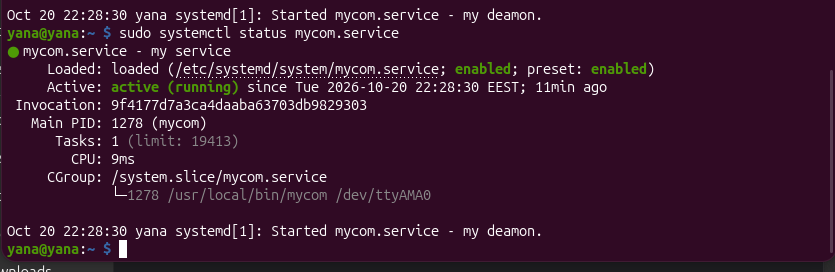
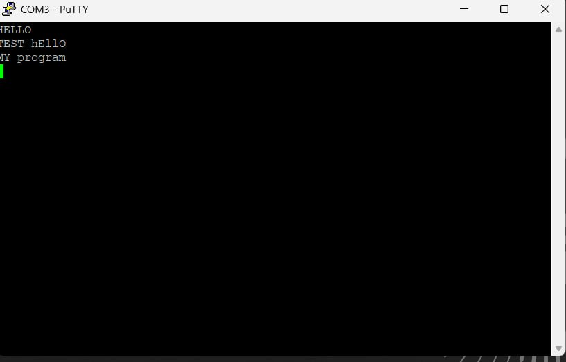
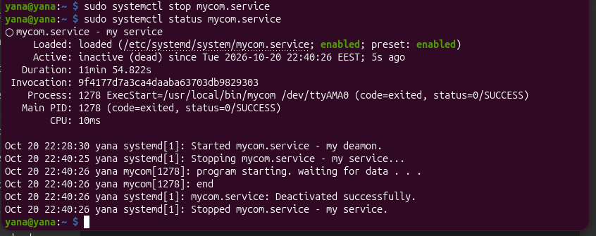
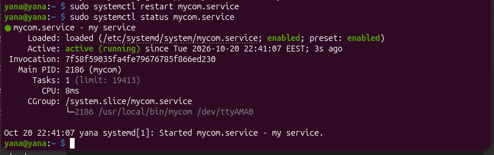

У ході виконання роботи було налагоджено систему двостороннього обміну даними. Під час налаштування виникли проблеми :

- у ході тестування каналу зв'язку було виявлено і усунено проблему з пошкодженим проводом на лінії TX.
- розроблено застосунок мовою С та усунено проблему "шуму" у терміналі шляхом точного налаштування posix-режимів через структуру termios (переведення порту в сирий режим без екранування та канонічної обробки)
- також за вимогою завдання було реалізовано посимвольне читання буфера (програма розпізнає кінець вводу за допомогою спец-символу, змінює регістр і відправляє результат назад у термінал клієнта та зберігає історію повідомлень у лог-файл з часовими мітками
- фінальним етапом стало налаштування автоматичного запуску програми при завантаженні таргет-системи. під час розгортання було проведено успішний дебаг помилки status=203/EXEC, що вимагало надання файлу відповідних прав доступу та налаштування абсолютних шляхів у конфігурації

Виконання TASK06:

У ході виконання завдання було реалізовано автоматичний запуск програми mycom на TARGET за допомогою systemd :
- розроблено unit-файл (mycom.service) який забезпечує автоматичний запуск програми 
- доповнено Makefile.

Сервіс коректно запускається та працює у фоновому режимі 

Сервіс коректно завершується командою systemctl stop та перезапускається командою systemctl restart

